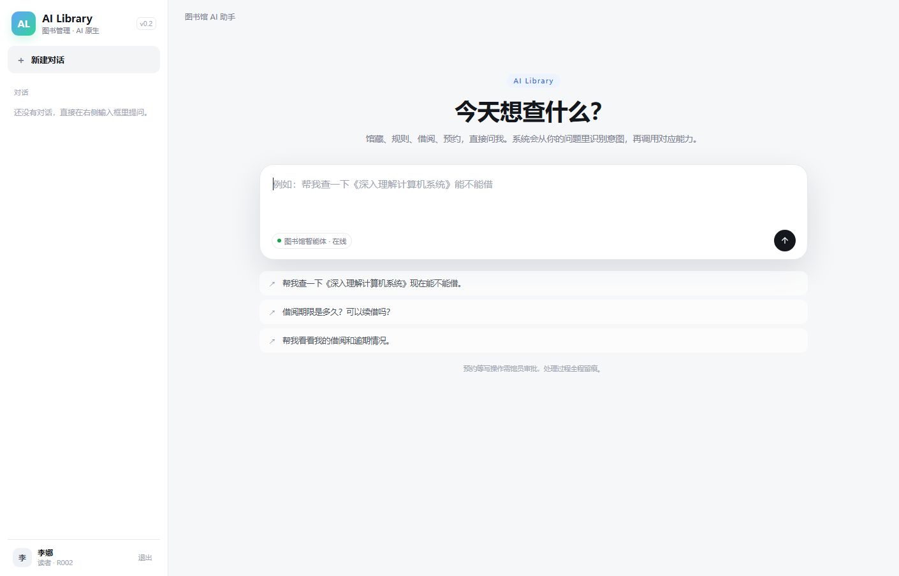

# AI Library Demo

> 一个以图书管理系统为业务载体的 **AI 原生企业框架** 参考实现：五层架构 × Pi SDK × DeepSeek。
>
> 主界面是对话优先的读者工作台，不把“读者服务 / 馆藏查询 / 借阅规则”做成分栏；意图由 Agent 从用户输入中识别。技术细节收在受 RBAC 保护的开发者视图里。



登录页与开发者视图截图：[docs/ui-login.png](docs/ui-login.png) · [docs/ui-developer.png](docs/ui-developer.png)

## 快速开始

要求 **Node.js 26+**（用到 `node:sqlite`）和 pnpm。

```bash
git clone https://github.com/hao-wxf/ai-library-demo.git
cd ai-library-demo
pnpm install

cp .env.example .env      # Windows: copy .env.example .env
# 编辑 .env，填入你自己的 DEEPSEEK_API_KEY

pnpm start
```

打开 **http://127.0.0.1:8787**

`.env` 由 Node 的 `--env-file-if-exists` 加载；没有 `DEEPSEEK_API_KEY` 时服务会明确失败，不会静默退回假模型。

```dotenv
DEEPSEEK_API_KEY=你的 key
DEEPSEEK_MODEL=deepseek-flash
# COOKIE_SECURE=1   # 生产 HTTPS 环境
```

**不要把 `.env` 提交到仓库。** `.env` 已在 `.gitignore` 中；`data/`、`temp/`、`node_modules/` 也不会提交。

### 演示账号

登录页只列读者演示账号；馆员/审计员/管理员用于 RBAC 评审，密码在此表中。

| 用户名 | 密码 | 角色 | 说明 |
|---|---|---|---|
| `zhangwei` | `reader123` | reader | R001 张伟，正常读者 |
| `lina` | `reader123` | reader | R002 李娜，有逾期；预约触发审批 |
| `wangfang` | `reader123` | reader | R003 王芳 |
| `librarian` | `librarian123` | librarian | 馆员；可审批、看开发者视图 |
| `auditor` | `auditor123` | auditor | 审计员；开发者视图只读 |
| `admin` | `admin123` | admin | 管理员 |

> 这些只是本地演示账号。生产环境必须接入统一身份 / SSO，并使用真实的密码策略、MFA、会话管理和审计。

### 推荐演示顺序

1. 用 `lina / reader123` 登录，直接问：“帮我预约《人工智能：一种现代的方法》。”
2. DeepSeek 自行识别意图，调用馆藏检索和预约工具；因为李娜有逾期，生成审批号，而不是直接创建预约。
3. 退出，用 `librarian / librarian123` 登录，打开右上角 **开发者视图 → 审批**，批准申请。
4. 在 **审计** 页看到 `reservation_create | approved | created` 以及完整工具调用链。
5. 退出，用 `zhangwei / reader123` 登录，问馆藏、规则、借阅；读者看不到开发者视图，服务端也不会返回 Trace。
6. 用 `auditor / auditor123` 登录，可以看 Trace/审批/审计，但审批按钮不可用；服务端会拒绝处理审批。

---

## 五层架构

| 层 | 本项目中的实现 | 目录 |
|---|---|---|
| **意图层 Intent** | 身份、角色、策略、工具授权、审批角色、Agent 提示 | `packages/policy-sdk`, `packages/agent-sdk` |
| **知识层 Knowledge** | 图书馆本体、制度文档、检索与引用 | `packages/knowledge-sdk` |
| **编排层 Orchestration** | Pi Durable Harness、GenerationTask、工具调用、会话隔离、Trace | `packages/agent-sdk` |
| **能力层 Capability** | 图书/读者/借阅/预约/罚款/采访/连续出版物/电子资源/馆际互借/盘点/活动/报表、工具契约、聊天会话映射 | `packages/capability-sdk`, `packages/contracts` |
| **基础设施层 Infrastructure** | SQLite 业务库、Pi Agent 持久化、认证会话、审计、HTTP 服务 | `packages/auth-sdk`, `apps/server`, `data/` |

### Pi SDK × DeepSeek 的接入点

- `@earendil-works/pi-ai`：内置 `deepseekProvider()` + `deepseek-flash`（`DEEPSEEK_API_KEY`）；
- `@earendil-works/pi-durable`：`Harness`、`createConversation`、`defineTool`、`section`、`openNodeSqliteStorage`；
- `@earendil-works/pi-schema`：工具参数 Schema；
- `@earendil-works/chord`：运行上下文。

Pi 只做**编排与持久化执行**，不替代业务能力、策略、知识和审计。DeepSeek 负责理解与规划，工具调用由 Pi 执行，写操作由代码策略裁决。

能力层当前是 **23 个 Native Tool**（`defineTool` 注册，不是 MCP），覆盖采访、编目/馆藏、流通、预约、罚款、读者、通知、连续出版物、电子资源、馆际互借、盘点、活动、报表；MCP 适用场景、外部协议缺口、以及“不使用 Pi SDK 会怎样”的完整分析见 **[docs/five-layers-pi-sdk.md](docs/five-layers-pi-sdk.md)**。

---

## RBAC 与开发者视图

登录使用服务端会话 + `HttpOnly` Cookie；角色在服务端校验，不依赖前端隐藏按钮。

| 能力 | reader | librarian | auditor | admin |
|---|---:|---:|---:|---:|
| 聊天 / 查馆藏 / 查制度 | ✅ | ✅ | ✅ | ✅ |
| 查本人借阅 | ✅ | ✅ | ✅ | ✅ |
| 查任意读者 | ❌ | ✅ | ✅ | ✅ |
| 创建预约 | 仅本人 | ✅ | ❌ | ✅ |
| 查看审批列表 | ❌ | ✅ | ✅ | ✅ |
| 处理审批 | ❌ | ✅ | ❌ | ✅ |
| 开发者视图 / Trace | ❌ | ✅ | ✅ | ✅ |
| 查看审计 | ❌ | ✅ | ✅ | ✅ |

- 读者访问 `/api/approvals`、`/api/audit`、其他读者的对话，服务端返回 403。
- 审批接口从会话取 `decidedBy`，不信任请求体；馆员不能审批自己发起的申请。
- `/api/chat` 只对工作人员返回 `trace`；读者响应里没有 Trace。
- 会话 Cookie 使用 `HttpOnly; SameSite=Lax; Path=/`；`COOKIE_SECURE=1` 时加 `Secure`。

---

## 目录

```text
apps/
  server/src/main.ts       HTTP API + 静态 UI + 认证/RBAC + 审批/审计
  web/                     原生 Web UI（无构建步骤）
packages/
  contracts/               五层契约：Tool / Policy / Approval / Audit / Trace / User
  auth-sdk/                演示账号、密码哈希、服务端会话、角色权限
  policy-sdk/              意图层：角色工具授权、借阅/预约/审批策略
  knowledge-sdk/           知识层：本体、制度库、检索
  capability-sdk/          能力层：SQLite 业务服务、聊天会话映射
  agent-sdk/               编排层：DeepSeek、Pi Harness、工具、动态提示、会话
docs/
  five-layers-pi-sdk.md    五层 × Pi SDK 技术文档
  architecture.md          架构与五层说明
  contracts.md             契约说明
test/                      node:test 测试
scripts/smoke.ts           真实 DeepSeek + RBAC 端到端回归
```

---

## 开发命令

```bash
pnpm start        # 启动 Web + API（加载 .env）
pnpm test         # 策略/知识/业务/认证测试
pnpm check        # TypeScript 类型检查
pnpm smoke        # 真实 DeepSeek 同链路回归（需服务已启动）
pnpm reset        # 清空业务库和 Pi Agent 状态（先停服务）
```

`pnpm smoke` 需要真实模型和网络，会消耗 Token。回归覆盖：读者检索、制度检索、逾期预约触发审批、跨用户会话 403、馆员审批、审计落库。

---

## 重要说明

- **真实模型**：默认 `deepseek-flash`；通过 `DEEPSEEK_MODEL` 可换 Pi 目录中已有的 DeepSeek 模型。模型调用会产生费用。
- **工具名使用下划线**：DeepSeek/OpenAI 函数名只接受 `[a-zA-Z0-9_-]`，因此工具是 `catalog_search`、`reservation_create` 等，而不是带点号的名字。
- **会话持久化**：`chat_conversations` 保存 UI 对话 ID → Pi conversation ID 的映射；Pi 消息在 `data/agent.sqlite`，业务数据在 `data/library.sqlite`。浏览器端消息列表保存在当前用户的 localStorage。
- **认证是演示级**：账号在内存中，服务重启后会话失效；生产应接 SSO/OIDC、MFA、集中会话、限流与安全审计。
- **知识检索是轻量实现**：生产替换为本体 + GraphRAG/向量服务，保留引用、版本和数据权限。
- **审批是应用层闭环**：生产应把审批等待做成 Pi 的持久化任务，人工确认后恢复 Agent 运行。
- **SQLite 是演示基础设施**：生产替换 PostgreSQL、模型网关、密钥管理、审计平台。
- **不是全自动政务决策**：法定决策、资金、PII 等高风险操作必须人工审批；AI 负责理解、检索、规划和辅助。

---

## 一句话

> 平台提供五层原语，Pi 负责持久化编排与执行，DeepSeek 负责理解与规划，业务系统负责能力与治理；模型规划，代码治理，人做最终确认。

---

## GitHub 仓库

- 公开仓库：<https://github.com/hao-wxf/ai-library-demo>
- 默认分支：`main`
- 许可证：MIT
- CI：`.github/workflows/ci.yml`，push / PR 时运行 `pnpm check` 和 `pnpm test`

任何人都可以克隆和 Fork；直接向仓库推送分支需要协作者权限（Settings → Collaborators 邀请）。协作分支、PR、同步和提交边界见 [CONTRIBUTING.md](CONTRIBUTING.md)，技术细节见 [docs/five-layers-pi-sdk.md](docs/five-layers-pi-sdk.md) 第 12 节。

**不要提交** `.env`、API Key、`data/*.sqlite*`、`temp/`、`node_modules/`。每个协作者使用自己的 `DEEPSEEK_API_KEY`。

## 参与贡献

见 [CONTRIBUTING.md](CONTRIBUTING.md)。欢迎 fork、提 issue、提 PR；新增能力层工具时请同步更新契约、策略、Trace/Audit 和技术文档。

## License

[MIT](LICENSE) © 2026 hao-wxf
