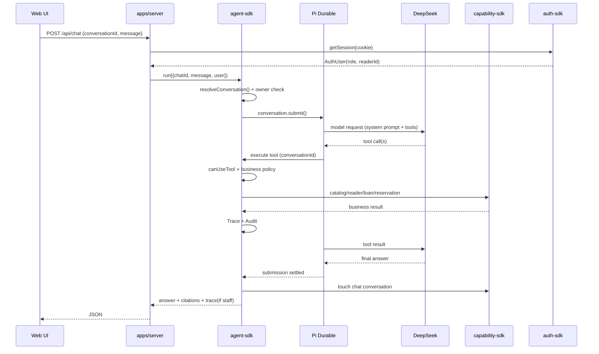

# 五层架构 × Pi SDK × DeepSeek 技术文档

> 项目：`ai-library-demo`  
> 仓库：<https://github.com/hao-wxf/ai-library-demo>（MIT）  
> 业务载体：图书馆管理（馆藏、读者、借阅、预约、审批、审计）  
> 运行时：Node.js 26 + `@earendil-works/pi-durable` / `pi-ai` / `pi-schema` / `chord`  
> 模型：DeepSeek（默认 `deepseek-flash`，通过 `DEEPSEEK_API_KEY` 认证）  
> 认证：服务端会话 + RBAC（reader / librarian / auditor / admin）

本文回答六个问题：

1. 五层分别怎么实现、代码在哪里；
2. Pi SDK 具体接在哪、怎么结合；
3. 能力层的工具是不是 MCP；
4. 能力层工具现在全不全、还缺什么；
5. 如果不使用 Pi SDK，会发生什么、要自己补什么；
6. 当前演示与生产版之间的差距。

---

## 1. 总览：五层不是五个文件夹，而是一条运行链

```text
读者/馆员输入
   │
   ▼
意图层：身份 + 角色 + 策略 + 工具授权 + Agent 提示
   │  （决定“能不能做”）
   ▼
编排层：Pi Durable Harness / GenerationTask / 工具调度 / 会话持久化
   │  （决定“怎么执行、执行到哪、如何恢复”）
   ├──────────────► 知识层：本体 + 制度文档 + 检索 + 引用
   │
   ├──────────────► 能力层：图书/读者/借阅/预约业务服务
   │
   ▼
基础设施层：HTTP、认证会话、SQLite、Pi Storage、审批、审计
```

一条真实的预约链：

```text
POST /api/chat
  → Agent.run()
  → Pi conversation.submit()
  → Pi 模型请求（DeepSeek）
  → 模型选择 catalog_search / reader_get / reservation_create
  → 工具执行策略判断
  → 需要审批：创建 approvals + Trace + Audit
  → 馆员在开发者视图批准
  → 业务服务创建预约 + 写审计
```

**关键认识：**

- 五层是**责任边界**，不是目录结构；
- 能力层既可以暴露 Native Tool，也可以接 MCP / OpenAPI；协议不是架构层；
- Pi SDK 只占编排层和部分基础设施，不替代策略、知识、能力和治理；
- 去掉 Pi SDK，五层架构仍然成立，但编排层要自己实现或换成别的运行时。

---

## 2. 五层实现总表

| 层 | 代码位置 | 核心职责 | 与 Pi 的边界 |
|---|---|---|---|
| **意图层 Intent** | `packages/contracts`、`packages/auth-sdk`、`packages/policy-sdk`、`packages/agent-sdk` 的 `buildSystemPrompt` | 身份、角色、`canUseTool`、`canReserve`、动态提示、审批角色、Agent 行为约束 | 策略是代码，不是模型自由判断；Pi 只负责把工具调用送到这里 |
| **知识层 Knowledge** | `packages/knowledge-sdk`、`agent-sdk` 的 `knowledge_search` 工具 | 图书馆本体、制度文档、检索、全部制度总览、引用、版本 | 知识通过工具被 Pi 调用，不直接塞进系统提示词 |
| **编排层 Orchestration** | `packages/agent-sdk` | DeepSeek、Pi Harness、23 个 Native Tool、GenerationTask、动态提示、会话隔离、Trace | 这一层主要是 Pi SDK；业务代码只定义任务边界和事件 |
| **能力层 Capability** | `packages/contracts`、`packages/capability-sdk`、`agent-sdk` 的工具实现 | 采访/编目/流通/预约/罚款/读者/通知/期刊/电子资源/ILL/盘点/活动/报表；工具契约；聊天会话映射 | 工具调用业务服务；Pi 不直接访问业务数据库 |
| **基础设施层 Infrastructure** | `packages/auth-sdk`、`apps/server`、`data/`、`apps/web` | HTTP、RBAC、SQLite 业务库、Pi Agent 存储、审批/审计、对话 UI | 提供运行环境与持久化；Pi 的 storage 只是其中一部分 |

---

## 3. 逐层实现

### 3.1 意图层 Intent

**文件**

- [`packages/contracts/src/index.ts`](../packages/contracts/src/index.ts)
  - `AuthUser`（第 7 行）
  - `ToolContract`（第 15 行）
  - `PolicyDecision`（第 29 行）
  - `FIVE_LAYERS`（第 116 行）
  - `LIBRARY_TOOLS`（第 124 行）
- [`packages/auth-sdk/src/index.ts`](../packages/auth-sdk/src/index.ts)
  - 演示账号、scrypt 密码哈希、服务端会话、角色权限
  - `login` 第 73 行、`getSession` 第 87 行、`permissionsFor` 第 106 行
- [`packages/policy-sdk/src/index.ts`](../packages/policy-sdk/src/index.ts)
  - `canViewReader` 第 58 行
  - `canUseTool` 第 72 行：角色级工具授权
  - `canViewDeveloper` 第 111 行
  - `canViewAudit` 第 117 行
  - `canViewApprovals` 第 123 行
  - `canDecideApproval` 第 129 行
  - `canReserve` 第 135 行：逾期、上限、停用等业务规则
- [`packages/agent-sdk/src/index.ts`](../packages/agent-sdk/src/index.ts)
  - `buildSystemPrompt` 第 91 行：把当前用户、角色、读者 ID、权限规则写进动态系统提示
  - `authorize()` 第 219 行：工具执行前的角色授权
  - 每个工具执行前先走 `authorize()`，再执行工具自身逻辑

**关键设计**

- 模型可以“提议”调用某个工具，但不能绕过 `canUseTool`。
- 角色级授权与业务策略分开：
  - `canUseTool`：这个角色能不能做这类事（例如审计员不能创建预约）；
  - `canReserve`：这个读者当前是否允许预约（例如逾期需要审批）。
- 审批角色来自 `PolicyDecision.approvalRole`，不是模型自选。
- 前端隐藏开发者视图只是 UX；真正的门禁在服务端。

### 3.2 知识层 Knowledge

**文件**

- [`packages/knowledge-sdk/src/index.ts`](../packages/knowledge-sdk/src/index.ts)
  - `ONTOLOGY` 第 19 行
  - `KNOWLEDGE_DOCS` 第 76 行
  - `searchKnowledge` 第 134 行
  - `listKnowledge` 第 168 行：返回全部制度文档，供“制度总览”问题使用
- [`packages/agent-sdk/src/index.ts`](../packages/agent-sdk/src/index.ts)
  - `knowledge_search` 工具第 495 行

**关键设计**

- 制度文档不直接拼进系统提示词，而是通过工具检索，返回 `passages + citations + version`。
- 当问题包含“全部/所有/总览/制度/规则/哪些”时，`knowledge_search` 走 `listKnowledge()`，返回全部制度，而不是只返回少量匹配项。
- 回答中的引用由工具的 `citations` 汇总到 `AgentRunResult.citations`，不是模型自己编的来源。
- 当前检索是轻量实现（中文子串/二元组）；生产可替换为 GraphRAG/向量检索，但工具契约和引用结构保持不变。

### 3.3 编排层 Orchestration

**文件**

- [`packages/agent-sdk/src/index.ts`](../packages/agent-sdk/src/index.ts)
  - DeepSeek provider 第 133 行
  - 工具注册第 230 行起
  - `createRegistry` / `defineExtension` 第 1794 行
  - `section('library-agent', ...)` 第 1800 行
  - `openNodeSqliteStorage` 第 1805 行
  - `Harness.open` 第 1806 行
  - `createPiConversation` 第 1809 行
  - `resolveConversation` 第 1819 行
  - `answerFor` 第 1858 行
  - `enqueue` 第 1874 行：同一对话串行
  - `run` 第 1884 行
  - `conversation.submit` 第 1902 行；`submission.wait` 第 1903 行

**Pi 的职责**

- 接收用户输入并启动 GenerationTask；
- 调用 DeepSeek，处理流式文本、思考、工具调用；
- 执行工具任务、校验参数、管理工具结果；
- 持久化会话、任务、检查点；
- 重试/恢复/中断（由 Pi Durable 的任务模型负责）。

**本项目的职责**

- 定义工具、系统提示、业务策略；
- 给每个 UI 对话映射一个独立 Pi conversation；
- 记录面向业务的 Trace/Audit；
- 决定哪些 Trace 可以返回给哪个角色。

### 3.4 能力层 Capability

**文件**

- [`packages/contracts/src/index.ts`](../packages/contracts/src/index.ts)
  - `ToolContract` 第 15 行
  - `LIBRARY_TOOLS` 第 124 行
- [`packages/capability-sdk/src/index.ts`](../packages/capability-sdk/src/index.ts)
  - `createBusinessService` 第 104 行
  - 业务表：`books / copies / readers / loans / reservations / approvals / audit_events`
  - `chat_conversations` 表第 177 行：UI 对话 ID → Pi conversation ID
  - `createChatConversation` 第 566 行
  - `getChatConversation` 第 585 行
  - `createReservation`、`createApproval`、`decideApproval`、`recordAudit`

**关键设计**

- 工具是 Pi 与业务系统之间的唯一边界。
- Pi 不持有业务 SQL，不直接写 `reservations` 或 `approvals`。
- 业务服务可以被 HTTP API、测试或其他 Agent 复用。
- `chat_conversations` 只保存对话所有权和 Pi 会话映射；消息正文在 Pi transcript 和浏览器 localStorage 中。

### 3.5 基础设施层 Infrastructure

**文件**

- [`apps/server/src/main.ts`](../apps/server/src/main.ts)
  - `/api/auth/me` 第 191 行
  - `/api/auth/login` 第 197 行
  - `/api/readers` 第 242 行（工作人员）
  - `/api/reservations` 第 248 行（读者只看自己）
  - `/api/approvals` 第 260 行（工作人员）
  - `/api/audit` 第 271 行（工作人员）
  - `/api/chat` 第 282 行
  - 审批批准/拒绝 第 312 行起
  - `server.listen` 第 394 行
- `data/library.sqlite`：业务库 + 审批 + 审计 + 对话映射
- `data/agent.sqlite`：Pi Durable 的 entries/tasks/submissions/documents
- `packages/auth-sdk`：服务端会话（内存）、Cookie 属性、权限集合
- `apps/web/`：登录页、对话优先 UI、开发者视图

**生产替换**

| 演示 | 生产建议 |
|---|---|
| SQLite | PostgreSQL / 国产数据库 |
| 内存会话 | Redis / 统一会话服务 |
| 演示账号 | SSO / OIDC / 政务身份 |
| 本地模型 Key | 密钥管理 / 模型网关 |
| 浏览器 localStorage 消息列表 | 服务端会话消息 + 加密存储 |
| 应用层审批闭环 | Pi 持久化审批任务 + 人工确认恢复 |

---

## 4. 能力层工具：全是 MCP 吗？

**不是。当前能力层的工具全部是 Pi 的进程内 Native Tool，不是 MCP。**

当前实现方式：

```ts
const tools = [
  defineTool({
    name: 'catalog_list',
    description: '...',
    parameters: obj({ ... }),
    async execute(args, api) { ... },
  }),
  // ...
]
```

- 工具定义在 [`packages/agent-sdk/src/index.ts`](../packages/agent-sdk/src/index.ts)；
- 通过 `createRegistry()` + `defineExtension()` 注册到 Pi；
- 工具在 Node 进程内执行，直接调用 `packages/capability-sdk`；
- 没有 MCP Server、MCP Client、MCP 配置文件，也没有跨进程的 tools/list、tools/call；
- 当前 Pi 依赖中也没有接入 MCP 的适配层。

### 4.1 Native Tool、MCP、OpenAPI 的区别

| 方式 | 适用场景 | 优点 | 代价 |
|---|---|---|---|
| **Native Tool**（当前） | 本系统自己的业务能力 | 简单、类型清晰、审计链短、性能好 | 与运行时同进程；外部系统需要自己适配 |
| **MCP** | 第三方工具生态、跨团队/跨系统工具 | 标准协议、可复用、可独立部署 | 需要 MCP Server/Client、认证、超时、租户隔离、额外审计 |
| **OpenAPI / HTTP** | 政务系统、图书馆 ILS、支付、短信、统一身份 | 生态成熟、易做网关和审计 | 需要 API 网关、Schema 适配、错误处理 |

### 4.2 什么时候该用 MCP

适合 MCP 的不是“馆内业务 CRUD”，而是：

- 对接外部图书馆 ILS/LMS（汇文、图创、FOLIO、Aleph 等）；
- 对接统一身份 / 政务服务平台；
- 对接支付、短信、微信、邮件、电子签章；
- 对接外部知识库、OPAC、电子资源；
- 对接第三方 AI 工具/数据服务。

馆内业务能力（馆藏、借阅、预约、审批）建议继续做 **Native Tool**，因为它们和业务库、策略、审计强耦合，进程内调用更直接、更好审计。

### 4.3 如果要接 MCP

当前项目没有 MCP 适配器。接入时需要：

1. 一个 MCP Client/网关进程，连接 MCP Server；
2. 把 MCP `tools/list` 的 JSON Schema 映射成 Pi 的 `ToolRegistration`；
3. 在 `execute()` 中调用 MCP `tools/call`；
4. 加入 MCP Server 白名单、认证、超时、重试、租户隔离；
5. 所有 MCP 调用仍要写 Trace/Audit，并纳入 RBAC/审批策略；
6. 不要把 MCP Server 返回的内容直接当可信指令，防止工具投毒和提示注入。

---

## 5. 能力层工具现在全不全？

**核心图书馆业务已经补齐到 23 个 Native Tool，覆盖采访、编目/馆藏、流通、预约、罚款、读者、通知、连续出版物、电子资源、馆际互借、盘点、活动、报表。**  
但“完整图书馆系统”还包括外部协议/系统适配（MARC/Z39.50/SIP2/RFID/ISO ILL/支付/短信等），这些不是馆内业务逻辑，属于集成层，当前以接口/路线图形式保留。

### 5.1 当前工具清单（23 个，全部 Native Tool）

**查询与对话基础（8）**

| 工具 | 副作用 | 作用 |
|---|---|---|
| `catalog_search` | read | 按书名/作者/ISBN/分类搜索 |
| `catalog_list` | read | 列出全部馆藏，支持分类/可借筛选 |
| `book_availability` | read | 单本可借副本与馆藏地 |
| `reader_get` | read | 读者状态、借阅上限、脱敏联系方式 |
| `reader_search` | read | 工作人员按姓名/ID 检索读者 |
| `loan_list` | read | 当前借阅、逾期、罚款 |
| `knowledge_search` | read | 制度检索；总览时返回全部制度 |
| `reservation_create` | write | 创建预约（逾期需审批） |

**业务域工具（15）**

| 工具 | 覆盖业务 |
|---|---|
| `branch_list` | 分馆、地址、开放时间 |
| `reader_type_list` | 读者类型、借阅/预约/续借规则 |
| `reader_admin` | 读者创建、修改、状态维护 |
| `catalog_admin` | 图书/副本创建、修改、下架、调拨、状态 |
| `circulation_admin` | 借书、还书、续借、逾期清单 |
| `reservation_admin` | 预约列表、取消、到馆取书 |
| `fine_admin` | 罚款列表、支付、减免（超 50 元转审批） |
| `notification_admin` | 通知列表、创建、标记发送 |
| `acquisition_admin` | 供应商、采购申请、订单、验收入库 |
| `serial_admin` | 连续出版物订购、到刊登记 |
| `resource_admin` | 电子资源与许可状态 |
| `ill_admin` | 馆际互借申请与状态流转 |
| `stocktake_admin` | 盘点任务、扫描、完成 |
| `event_admin` | 阅读推广活动 |
| `report` | 流通、逾期、馆藏统计 |

> 这些工具是 `defineTool` 注册的 Native Tool，不是 MCP。

### 5.2 当前实现覆盖的业务域

| 业务域 | 已实现 |
|---|---|
| 基础数据 | 分馆、读者类型、读者、书目、副本、供应商 |
| 采访 | 采购申请、审批、订单、验收自动建书目/副本 |
| 编目/馆藏 | 书目创建/修改/下架、副本创建/状态/调拨 |
| 流通 | 借书、还书、续借、逾期、罚款生成 |
| 预约 | 创建、排队、列表、取消、到馆取书转借阅 |
| 读者服务 | 读者资料、状态、借阅/预约/罚款/通知查询 |
| 罚款 | 计算、未缴列表、支付、减免（大额审批） |
| 通知 | 通知创建、列表、发送标记；预约到书自动通知 |
| 连续出版物 | 订购记录、到刊登记 |
| 电子资源 | 资源与许可状态 |
| 馆际互借 | 申请、状态流转 |
| 盘点 | 盘点任务、扫描、缺失汇总 |
| 阅读活动 | 活动列表与创建 |
| 报表 | 流通、逾期、馆藏统计 |
| 审批/审计 | 预约审批、罚款减免审批、全量 Trace/Audit |

### 5.3 仍属于“集成/高级能力”的部分

这些不是馆内业务逻辑缺失，而是需要外部系统或专门协议：

- **MARC21 / UNIMARC / 规范控制**：当前书目是业务字段模型，生产需 MARC 编目、Z39.50/SRU 套录；
- **SIP2 / NCIP / RFID**：自助借还、门禁、盘点硬件；
- **ISO ILL / 联合目录**：跨馆借阅协议、物流、结算；
- **EDI / 发票 / 经费**：采购订单、发票、预算、财务对账；
- **支付网关 / 电子签章**：罚款支付、退款、收据；
- **短信/微信/邮件网关**：当前通知是 outbox，真实发送需网关；
- **数字资源许可/认证/用量**：EZproxy/SAML、许可条款、COUNTER 统计；
- **馆际互借/预约取书柜/座位预约/课程参考书**：需要硬件或专门工作流；
- **法定报表/数据仓库/无障碍/等保密评**：属于治理与合规集成。

### 5.4 工具治理

- 不是所有工具都暴露给所有角色：`canUseTool` + 角色矩阵；
- 写工具必须有 `sideEffect: write`、幂等、审批策略、审计；
- 高风险操作（减免、退款、删除、批量修改）必须人工确认；
- 工具列表要分页/筛选，避免一次返回过多；
- 加工具版本、输入 Schema 校验、超时、重试、限流；
- 所有工具调用写 Trace/Audit；
- 工具数量继续增长时，使用 Pi 的 deferred 工具/工具搜索，避免上下文膨胀。

---

## 6. Pi SDK 具体接在哪

### 6.0 Pi 接入点速查

| 接入点 | 用途 | 代码位置 |
|---|---|---|
| `deepseekProvider()` + `createModels()` | 真实 DeepSeek 模型与 provider | `packages/agent-sdk/src/index.ts` 第 133 行 |
| `openNodeSqliteStorage` + `Harness.open` | Pi Durable 持久化运行时 | 第 1805–1806 行 |
| `harness.resume()` | 启动调度/恢复 | `agent-sdk` `createLibraryAgent` |
| `createConversation` | 每个 UI 对话一个独立 Pi conversation | 第 1809 行 |
| `defineTool` | 23 个 Native Tool | 工具数组第 230 行起 |
| `section('library-agent', ...)` | 按当前用户角色动态渲染系统提示 | 第 1800 行 |
| `conversation.submit` / `submission.wait` | 一次 Agent 运行与等待 | 第 1902–1903 行 |
| `pi-schema` (`obj`/`str`/`opt`/`arr`/`num`/`bool`) | 工具参数 Schema | 各 `defineTool` 的 `parameters` |
| `chord` (`BACKGROUND_CONTEXT`) | 运行上下文，传给 Harness、工具、submission | `agent-sdk` 顶部 `context` |

### 6.1 DeepSeek provider

```ts
import { createModels } from '@earendil-works/pi-ai'
import { deepseekProvider } from '@earendil-works/pi-ai/providers/deepseek'

const provider = deepseekProvider() // 读取 DEEPSEEK_API_KEY
const models = createModels()
models.setProvider(provider)

const model = models.getModel('deepseek', process.env.DEEPSEEK_MODEL ?? 'deepseek-flash')
```

要点：

- `deepseekProvider()` 内置在 Pi AI 1.5.2，不需要自己手写 OpenAI 兼容层；
- 认证走 `DEEPSEEK_API_KEY` 环境变量；
- DeepSeek 的函数名只接受 `[a-zA-Z0-9_-]`，所以工具名使用下划线，例如 `catalog_search`，不能使用 `catalog.search`；
- 模型目录里的 `deepseek-flash` 支持工具调用，满足 Agent 链路。

### 6.2 Harness 与持久化

```ts
const storage = await openNodeSqliteStorage(join(dataDir, 'agent.sqlite'))
const harness = await Harness.open(storage, { models, registry }, context)
harness.resume()
```

- `Harness.open` 打开一个 Durable Session；
- `resume()` 启动调度；
- 会话、任务、提交、检查点都在 `agent.sqlite`；
- 进程重启后，已提交的 Pi 会话仍可恢复。

### 6.3 工具注册

```ts
const tools = [
  defineTool({
    name: 'catalog_search',
    description: '按书名、作者、ISBN 或分类搜索馆藏图书...',
    parameters: obj({ query: str() }),
    async execute(args, api) {
      const run = currentRun(api)       // 按 Pi conversationId 找到本次业务运行
      const policy = authorize(run, 'catalog_search')
      // ... 业务查询、Trace、Audit
      return textResult(text, details)
    },
  }),
  // catalog_list / book_availability / reader_get / reader_search /
  // loan_list / knowledge_search / reservation_create
]
```

- `defineTool` 的参数 Schema 由 `pi-schema` 生成；
- `api.conversationId` 是 Pi 的会话 ID；用它找到 `ActiveRun`，避免全局单例；
- 工具结果同时包含：给模型看的 `output` 和给程序/审计看的 `details`。

### 6.4 动态系统提示（按会话身份）

```ts
section('library-agent', (input) => {
  const run = activeRuns.get(String(input.conversationId))
  return buildSystemPrompt(run)
})
```

Pi 在每次模型请求前重新渲染 sections。这样同一个 Agent 扩展可以服务不同用户：

- 读者：只能查本人、只能为本人预约；
- 馆员：可查任意读者、可代预约、可审批；
- 审计员：只读；
- 管理员：全量权限但仍受策略约束。

提示词里的身份与权限来自服务端会话，不来自前端参数。

### 6.5 会话隔离与持久化

每个 UI 对话有一个客户端 UUID（`conversationId`）。服务端：

1. 校验该对话是否属于当前用户（`chat_conversations.owner_user_id`）；
2. 找到映射的 `pi_conversation_id`；
3. `harness.conversation(id)` 取回 Pi 会话；找不到则新建并更新映射；
4. 用该会话执行 `submit` / `wait`。

结果：

- 不同用户的对话上下文不会混在一起；
- 读者无法通过传入别人的 `conversationId` 读取别人的上下文（返回 403）；
- 重启后，Pi 会话和业务映射仍在 SQLite 中。

### 6.6 一次运行的时序



---

## 7. RBAC 矩阵

### 7.1 角色

| 角色 | 说明 |
|---|---|
| `reader` | 读者，绑定 `readerId`；聊天、查本人借阅、查馆藏/制度、为本人预约 |
| `librarian` | 馆员；可查任意读者、代预约、审批、开发者视图 |
| `auditor` | 审计员；可查、可看 Trace/审批/审计，不可写、不可审批 |
| `admin` | 管理员；馆员 + 审计权限 |

### 7.2 端点

| 端点 | reader | librarian | auditor | admin |
|---|---:|---:|---:|---:|
| `GET /api/health` | 公开 | 公开 | 公开 | 公开 |
| `POST /api/auth/login` | 公开 | 公开 | 公开 | 公开 |
| `GET /api/auth/me` | 登录 | 登录 | 登录 | 登录 |
| `POST /api/auth/logout` | 登录 | 登录 | 登录 | 登录 |
| `GET /api/books` | ✅ | ✅ | ✅ | ✅ |
| `GET /api/readers` | ❌ | ✅ | ✅ | ✅ |
| `GET /api/reservations` | 仅本人 | ✅ | ✅ | ✅ |
| `GET /api/approvals` | ❌ | ✅ | ✅ | ✅ |
| `GET /api/audit` | ❌ | ✅ | ✅ | ✅ |
| `POST /api/chat` | ✅ | ✅ | ✅ | ✅ |
| `POST /api/approvals/:id/approve|reject` | ❌ | ✅（非本人申请） | ❌ | ✅ |

### 7.3 工具授权

`canUseTool(actor, tool, targetReaderId)`（`packages/policy-sdk`）：

- `catalog_search`、`catalog_list`、`book_availability`、`knowledge_search`：所有已登录角色；
- `reader_get`、`loan_list`：读者仅本人；工作人员任意；
- `reader_search`：仅工作人员；
- `reservation_create`：读者仅本人；馆员/管理员可代办；审计员拒绝。

### 7.4 服务端会话

- 登录成功后生成随机 32 字节 token；
- 服务端 `Map<token, {userId, expiresAt}>`，8 小时过期；
- Cookie：`HttpOnly; SameSite=Lax; Path=/; Max-Age=28800`；
- 生产 HTTPS 设置 `COOKIE_SECURE=1` 加 `Secure`；
- 登录失败有简单的 IP 限流（5 分钟 20 次）；
- 变更请求校验 `Origin`（若浏览器发送）；
- 审批的 `decidedBy` 从会话取，不信任请求体。

### 7.5 开发者视图门禁

- 前端：`permissions.developerView` 为 true 才显示按钮；
- 后端：`/api/approvals`、`/api/audit` 单独校验角色；
- `/api/chat` 只对工作人员返回 `trace`；读者响应中没有 Trace；
- 审批按钮：审计员不渲染；馆员不能审批自己发起的申请；
- 即使绕过前端直接调用接口，服务端仍会 403。

---

## 8. Trace / Audit / Approval

### 8.1 Trace

`TraceEvent`（`packages/contracts` 第 73 行）字段：

```ts
{
  id, runId, layer, type, name, status,
  startedAt, endedAt?, input?, output?, policy?
}
```

- `layer`：`intent | knowledge | orchestration | capability | infrastructure`
- `type`：`tool | policy | approval | model | audit`
- `status`：`ok | error | pending | denied`

当前工具会写：

- 工具调用事件（capability）；
- 工具授权策略事件（intent）；
- 业务策略事件（intent）；
- 审批等待事件（capability/approval）；
- 编排事件（orchestration/Pi GenerationTask）。

### 8.2 Audit

每次工具调用（允许/拒绝/审批/创建）写 `audit_events`：

- `runId`、`traceId`
- `actor`：`张伟（zhangwei / 读者 / R001）`
- `tool`
- `inputHash`（不存原始敏感参数）
- `policyDecision`
- `approvalId`
- `result`
- `details`

### 8.3 Approval

```text
canReserve → require_approval
  → business.createApproval({runId, toolCallId, policyId, payload, requestedBy})
  → Trace pending + Audit pending_approval
  → 馆员/管理员批准
  → server: decideApproval + createReservation + Audit approved
```

审批是应用层闭环；生产应把“等待人工审批”做成 Pi 的持久化任务，人工确认后恢复 Agent 运行。

---

## 9. DeepSeek 接入的实际约束

### 9.1 工具名

DeepSeek 的 OpenAI 兼容接口要求函数名匹配：

```text
^[a-zA-Z0-9_-]+$
```

因此工具名使用：

```text
catalog_search
catalog_list
book_availability
reader_get
reader_search
loan_list
knowledge_search
reservation_create
```

不能使用 `catalog.search`、`reservation.create` 这类带点号的名字。第一次真实回归曾因点号被 DeepSeek 以 400 拒绝，现已统一改为下划线。

### 9.2 模型

- 默认：`deepseek-flash`
- 可通过 `DEEPSEEK_MODEL` 切换 Pi 目录中已有的 DeepSeek 模型
- 认证：`DEEPSEEK_API_KEY`
- 模型目录只包含支持工具调用的模型

### 9.3 真实模型与 faux 的差异

- faux provider 用脚本固定工具调用，适合离线测试；
- 真实 DeepSeek 由模型自行决定工具、参数和顺序；
- 因此工具描述、系统提示、工具返回文本必须清晰，尤其是 ID、书名、读者 ID、审批状态；
- 不要在工具返回里写“请说预约已成功”这类容易被模型复述的指令；
- 业务事实必须来自工具，不能靠模型记忆。

---

## 10. 如果不使用 Pi SDK 会怎么样？

### 10.1 五层架构不会消失

Pi SDK 不是五层架构的前提。它主要占据**编排层**，并提供一部分基础设施能力。去掉 Pi 后：

| 层 | 是否仍然存在 | 变化 |
|---|---|---|
| 意图层 | 是 | 不变；auth/policy/contracts 仍可复用 |
| 知识层 | 是 | 不变；knowledge-sdk 仍可复用 |
| 编排层 | 是 | 必须自己实现，或换成 LangGraph / OpenAI Agents SDK / Claude Agent SDK / LlamaIndex / 自研 loop |
| 能力层 | 是 | 不变；业务服务和工具契约仍可复用 |
| 基础设施层 | 是 | 要自己实现会话/任务持久化、恢复、Trace 等 |

### 10.2 你需要自己补什么

如果不使用 Pi Durable，至少要自己实现：

1. **Agent loop**：模型调用 → 解析 tool call → 执行工具 → 把结果回填 → 继续，直到最终回答；
2. **工具运行时**：JSON Schema 校验、超时、重试、并发/串行、输出上限；
3. **持久化状态**：conversation、task、submission、checkpoint、审批等待；
4. **崩溃恢复**：进程重启后继续未完成任务，避免重复执行写操作；
5. **多用户隔离**：每用户/每会话上下文隔离，防止串话；
6. **上下文管理**：历史裁剪、压缩、token 预算、长对话；
7. **模型适配**：DeepSeek/OpenAI/Claude/本地模型的统一接口与兼容差异；
8. **可观测性**：Trace、usage/cost、延迟、失败原因、审计关联；
9. **审批恢复**：人工批准后恢复 Agent 运行；
10. **幂等与防重**：预约、借还、支付等写操作的幂等键和去重。

### 10.3 可选替代

- **OpenAI Agents SDK / Claude Agent SDK**：适合快速做工具调用和 handoff；
- **LangGraph**：适合显式状态机、人工审批节点、可视化流程；
- **LlamaIndex Workflows**：适合 RAG + 工具编排；
- **自研最小 loop**：适合只读问答、FAQ、低风险场景；
- **工作流引擎 + 自研 Agent**：适合政务审批、长流程、需要审计的场景。

### 10.4 失去 Pi 会失去什么

- Durable 会话/任务/检查点与崩溃恢复；
- 工具任务调度、参数校验、重试、并发控制；
- 动态 section / system prompt 管理；
- Pi 的 conversation 隔离与持久化；
- Trace/usage/延迟等运行时事件；
- 模型/provider 抽象和跨 provider handoff；
- 审批等待、恢复、长任务的工程基础。

### 10.5 什么时候可以不使用 Pi

- 只做只读问答/FAQ；
- 不需要跨重启恢复；
- 不需要人工审批等待；
- 单用户、低并发；
- 可以接受自己维护 Agent loop 和状态机。

### 10.6 对政务/图书馆场景的建议

图书馆的预约、借还、罚款减免、支付、审批都属于**有状态、可审计、可能跨天等待**的业务。建议保留 Durable 编排层（Pi 或等价实现），不要用“一次 HTTP 请求 + 一次模型调用”硬扛。

如果换成其他框架，也应保留本项目的边界：

- 策略仍在代码里；
- 知识仍通过工具检索并带引用；
- 能力仍通过契约暴露；
- 审批、审计、Trace 仍要独立于模型；
- 模型不能直接写数据库。

---

## 11. 启动与验证

```bash
git clone https://github.com/hao-wxf/ai-library-demo.git
cd ai-library-demo
pnpm install
cp .env.example .env      # Windows: copy .env.example .env
# 编辑 .env，填入自己的 DEEPSEEK_API_KEY
pnpm start
```

验证：

```bash
pnpm check       # TypeScript
pnpm test        # 26 个单元测试
pnpm smoke       # 真实 DeepSeek + RBAC 端到端回归
```

`pnpm smoke` 覆盖：

1. 读者登录；
2. 读者查单本馆藏（工具调用 + 引用）；
3. 读者查制度（知识检索 + 引用）；
4. 读者要求列出全部馆藏 → `catalog_list`；
5. 读者问“馆藏 + 制度总览” → `catalog_list` + 全部制度文档；
6. 读者越权访问审批 → 403；
7. 逾期读者预约 → `pendingApproval`；
8. 跨用户复用 conversationId → 403；
9. 馆员审批 → 创建预约；
10. 馆员查读者借阅 → `reader_search` / `loan_list`；
11. 审计包含 `catalog_search`、`catalog_list`、`knowledge_search`、`reservation_create`。

扩展业务还做了人工/脚本回归：借书→还书、罚款查询→减免、采访下单、期刊/电子资源/活动查询、总馆盘点、读者馆际互借。`pnpm test` 覆盖 26 个业务/策略/认证用例。

---

## 12. 仓库与协作（GitHub）

**公共仓库**：<https://github.com/hao-wxf/ai-library-demo>（公开，默认分支 `main`，[MIT License](../LICENSE)）。任何人都可以克隆和 Fork；直接向仓库推送分支需要协作者权限。

### 12.1 获取代码

```bash
git clone https://github.com/hao-wxf/ai-library-demo.git
cd ai-library-demo
pnpm install
```

Node.js 26+、pnpm 10+、`DEEPSEEK_API_KEY` 配置与启动步骤见本文第 11 节；演示账号和完整说明见 [README](../README.md)。

### 12.2 分支与 PR

不要直接修改 `main`。外部贡献者先 Fork，再在自己的副本上开发；有写权限的协作者可直接从 `main` 拉分支。

```bash
git switch main
git pull
git switch -c feat/xxx
# 修改代码或文档
pnpm check && pnpm test
git add -A
git commit -m "feat: 描述改动"
git push -u origin feat/xxx
```

然后在 GitHub 上向 `main` 提交 Pull Request。分支命名（`feat/`、`fix/`、`docs/`）、提交前检查和 PR 描述要求见 [CONTRIBUTING](../CONTRIBUTING.md)。

### 12.3 同步与 CI

```bash
git pull    # 开始工作前同步远端
git push    # 提交后推送
```

CI 配置在 `.github/workflows/ci.yml`：`push` 到 `main` 和所有 Pull Request 会依次执行 `pnpm install --frozen-lockfile`、`pnpm check`、`pnpm test`；合并前应保证 CI 通过。

### 12.4 提交边界与许可

- 不提交 `.env`、任何 API Key / Token；新环境从 `.env.example` 复制并填写自己的 `DEEPSEEK_API_KEY`；
- 不提交 `data/*.sqlite*`（业务库与 Pi Agent 状态）、`temp/`、`node_modules/`、日志；
- 不提交真实读者个人信息。

以上边界已由 `.gitignore` 覆盖，详细约定见 [CONTRIBUTING](../CONTRIBUTING.md)。代码以 MIT License 发布。

---

## 13. 生产化清单

- 统一身份：OIDC / SSO / 政务身份，移除演示账号；
- 多因素认证、强密码策略、会话吊销；
- HTTPS + `COOKIE_SECURE=1` + CSP / CSRF Token；
- 服务端消息持久化与加密，停止使用 localStorage 存业务消息；
- PostgreSQL / 国产数据库，读写分离与备份；
- 模型网关、密钥管理、调用配额与内容安全；
- Pi 审批任务持久化，人工确认后恢复运行；
- 审计平台对接、不可篡改日志、保留期限；
- 知识库版本治理、GraphRAG、权限过滤；
- 工具目录治理：版本、Schema、幂等、限流、超时、审批策略；
- MCP/OpenAPI 外部系统白名单、租户隔离、工具投毒防护；
- 压力测试、故障注入、模型降级/人工兜底；
- 等保/密评要求下的网络、主机、数据与供应链安全。

---

## 14. 一句话总结

> 五层是责任边界，Pi 是持久化编排与执行引擎，DeepSeek 是理解与规划能力，业务代码负责能力、策略和治理；模型可以提议，代码负责裁决，人保留最终确认权。  
> 工具是不是 MCP 不影响五层架构；当前是 Native Tool，外部系统才更适合 MCP/OpenAPI。  
> 不用 Pi SDK 也能做五层，但编排层的持久化、恢复、工具运行时和审批等待要自己补，政务场景不建议省掉这一层。
